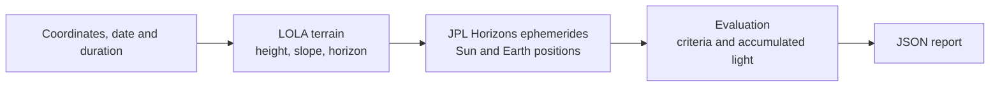
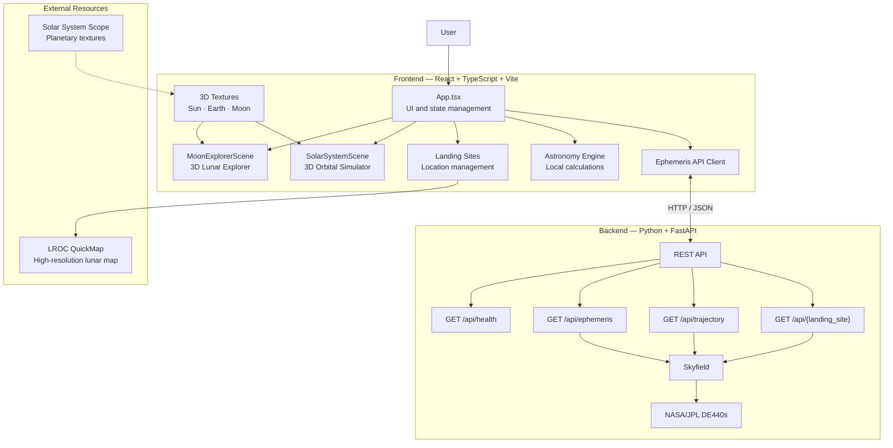

# 🌕 [One Safe Step for Mankind](https://ossm-lunar-navigator-web.onrender.com/)

**NASA Space Apps Challenge 2026 — Lunar Landing Site Navigator**

> **3D Sun–Earth–Moon Orbital Simulator & Lunar Landing Site Viability Explorer**

An interactive application and comprehensive analysis framework designed to explore the lunar surface, investigate potential landing sites, and simulate the orbital geometry of the Sun–Earth–Moon system.

The project combines real lunar topography (LOLA), high-resolution elevation models, astronomical data based on NASA/JPL ephemerides (JPL Horizons & DE440s), and rigorous geometric analysis of solar illumination and Earth visibility at lunar locations.

---

## Contents

* [Overview & What Does It Do?](https://www.google.com/search?q=%23overview--what-does-it-do)
* [1. Main Features](https://www.google.com/search?q=%231-main-features)
* [2. System Architecture & Code Layout](https://www.google.com/search?q=%232-system-architecture--code-layout)
* [3. Repository Structure](https://www.google.com/search?q=%233-repository-structure)
* [4. REST API — Backend Endpoints](https://www.google.com/search?q=%234-rest-api--backend-endpoints)
* [5. Landing Site Evaluation Criteria & Logic](https://www.google.com/search?q=%235-landing-site-evaluation-criteria--logic)
* [6. Running the Project & Getting Started](https://www.google.com/search?q=%236-running-the-project--getting-started)
* [7. Configuration and Deployment](https://www.google.com/search?q=%237-configuration-and-deployment)
* [8. Scientific Considerations & Limitations](https://www.google.com/search?q=%238-scientific-considerations--limitations)
* [9. External Data, Resources, Credits, and License](https://www.google.com/search?q=%239-external-data-resources-credits-and-license)
* [10. Glossary & AI Usage](https://www.google.com/search?q=%2310-glossary--ai-usage)

---

## Overview & What Does It Do?

Choosing where to land on the Moon means answering several questions at once: Is the ground flat enough? Will there be sunlight for power? Can Earth be seen for communications? This project answers all of them using official NASA data products and real astronomical ephemerides.

You provide **lunar coordinates**, a **start date**, and a **mission duration**. The system then:

1. Measures the **terrain** around the point: height, slope, and how high the horizon is in every direction.
2. Looks up where the **Sun and Earth** are, as seen from that point, throughout the mission.
3. Applies a set of **viability criteria** and returns a report with the decision and, if the site is not suitable, **every** reason why it fails.



Terrain is computed first because ephemerides require the height of the site.

> *Note: This is a geometric estimate. It does not certify that a landing is safe, but pinpoints when it is unsafe and provides exact reasons.*

---

## 1. Main Features

### 3D Lunar Explorer

Allows users to explore an interactive lunar globe and investigate potential landing sites for space missions.

* **Features:** 3D representation of the Moon, surface navigation/zoom, selection of lunar locations, selenographic coordinate lookup, custom location addition via latitude/longitude, and links to external high-resolution lunar mapping.
* **Reference locations included:**
* **IM-1 Odysseus (Malapert A):** NASA CLPS (`-80.13°`, `1.44°`)
* **Artemis III (Shackleton Rim):** NASA Artemis III (`-89.68°`, `129.00°`)
* **Apollo 11 (Tranquility Base):** NASA Apollo (`0.67°`, `23.47°`)


### 3D Orbital Simulator

Displays the orbital geometry of the Sun–Earth–Moon system in a three-dimensional environment.

* **Features:** Relative positions of the three celestial bodies, time-based simulation, simulation speed controls (`1 hour/s`, `1 day/s`, `1 month/s`), camera modes (top-down, heliocentric, geocentric), orbital telemetry, lunar phase information, and astronomical position/distance calculations.

### Landing Site Viability Assessment & Comparison

The system analyzes geometric conditions to determine whether a site offers favorable conditions for landing, takeoff, and surface operations. Users can compare different lunar locations and examine their solar illumination and Earth visibility conditions for a selected date.

---

## 2. System Architecture & Code Layout

The application follows a client-server architecture consisting of two independent services communicating via a REST API using JSON-formatted data (supported by Docker Compose during development):

* **Frontend:** React, TypeScript, Vite, and Three.js through React Three Fiber.
* **Backend:** Python, FastAPI, and Skyfield for astronomical calculations.

### Architecture Diagrams



### Layer Responsibilities

| Layer | Technology | Responsibility |
| --- | --- | --- |
| **Interface** | React 19 / Vite | Application management & compilation |
| **3D Visualization** | Three.js / React Three Fiber / Drei | Three-dimensional scenes & rendering utilities |
| **API Backend** | Python, FastAPI, Uvicorn | HTTP services & REST endpoints |
| **Astronomical Engines** | Skyfield / JPL Horizons | Positions, ephemerides, and vector transformations |
| **Terrain & Geometry** | LOLA / PGDA / Custom Python | Elevation grids, slope calculation, horizon profiles |
| **Deployment** | Docker / Render | Execution and hosting |

---

## 3. Repository Structure

```text
NASA_Hackathon_2026/
│
├── backend/
│   ├── evaluar.py                 # Single entry point: compute or re-evaluate (CLI)
│   ├── app/
│   │   ├── main.py                # FastAPI application and orbital routes
│   │   ├── terrain.py             # Terrain: height, slope and horizon (LOLA)
│   │   ├── evaluation.py          # Viability criteria and failure report
│   │   ├── lunar_api.py           # HTTP contract for lunar geometry
│   │   ├── astronomy/
│   │   │   ├── ephemeris.py       # Sun-Earth-Moon orbits (Skyfield) for visual API
│   │   │   └── lunar_geometry.py  # Ephemerides (JPL Horizons) and time series
│   │   └── data/
│   │       └── de440s.bsp         # NASA/JPL DE440s kernel
│   ├── tests/                     # Unit tests
│   ├── Dockerfile
│   ├── requirements.txt
│   ├── requirements.lock          # Exact versions for Python 3.12
│   └── requirements-dev.txt
│
├── frontend/
│   ├── src/
│   │   ├── App.tsx                # Application state, controls and scene selection
│   │   ├── main.tsx
│   │   ├── styles.css
│   │   ├── api/
│   │   │   ├── apiBase.ts
│   │   │   ├── ephemerisClient.ts
│   │   │   └── lunarGeometryClient.ts
│   │   ├── astronomy/
│   │   │   ├── ephemeris.ts
│   │   │   └── landingSites.ts
│   │   ├── components/
│   │   │   ├── CanvasErrorBoundary.tsx
│   │   │   ├── MoonExplorerScene.tsx
│   │   │   ├── RocketPlaceholder.tsx
│   │   │   └── SolarSystemScene.tsx
│   │   ├── hooks/
│   │   │   └── useStellarData.ts
│   │   ├── services/
│   │   │   └── getData.ts
│   │   └── model/
│   │       └── datosEstelares.ts
│   ├── package.json
│   └── Dockerfile
│
├── public/
│   └── textures/                  # Earth, Moon, and Sun display images
│
├── compose.yml
├── render.yaml
├── package.json
├── README.md
├── challenge.md
└── AI_use.md

```

---

## 4. REST API — Backend Endpoints

The backend uses FastAPI and exposes core operational endpoints and routes:

| Parameter / Config | Value |
| --- | --- |
| **Framework** | FastAPI |
| **Server** | Uvicorn |
| **Docker Port** | `8000` |
| **Development Port** | `3001` |
| **API Prefix** | `/api` |
| **Format** | JSON |

### Core Endpoints

* **`GET /api/health`**
Checks whether the backend service is operational. Returns status, service name, kernel in use (`de440s.bsp`), and UTC timestamp.
* **`GET /api/ephemeris`**
Retrieves astronomical information about the Sun–Earth–Moon system for a given date (supports query parameters `jd` or `year`, `month`, `day`, `hour`).
* **`GET /api/trajectory`**
Calculates a sequence of orbital points over a specified time interval (`jd`, `days`, `steps`).
* **`GET /api/{landing_site}`**
Evaluates the instant conditions of a lunar landing site for a specified date and coordinates (`fecha`, `lat`, `lon`, `name`).
* **`POST /api/lunar-geometry`**
Queries JPL Horizons for Sun and Earth geometry seen from a specific lunar site over a duration with a given time step.

---

## 5. Landing Site Evaluation Criteria & Logic

A site is viable only if it meets **all** criteria configured in the evaluation engine:

| Code | Criterion | Default Rule |
| --- | --- | --- |
| **1** | Terrain **slope** | The 95th percentile (P95) of the slope must be **below 15°** |
| **2** | **Valid data** | Input data must be complete, valid, and consistent with the site |
| **3** | **Unobstructed Sun** at start | Neither terrain nor an eclipse may block the Sun at the initial instant |
| **4** | **Earth visible** at start | Earth must be above the terrain horizon at the initial instant |
| **5** | **Solar elevation** at start | The Sun must be **more than 5°** above the horizon |
| **6** | **Accumulated light** | Hours of light must exceed **50%** of the mission hours |
| **7** | **Time coverage** | The data series must cover the whole requested duration |

### Possible Outcomes (`evaluar.py`)

* **`viable: true` (`viable`)**: Meets all criteria.
* **`viable: false` (`no_viable`)**: Fails at least one criterion. The report lists every evaluable failure.
* **`viable: null` (`datos_insuficientes`)**: Data is missing and no evaluated criterion has rejected the site.

---

## 6. Running the Project & Getting Started

### Requirements

* Python 3.12
* Node.js and npm (for the 3D explorer)
* Internet connection (for LOLA and JPL Horizons queries)

### Installation & Local Setup

1. **Clone and setup Python environment (PowerShell / Bash):**
```powershell
python -m venv .venv
.\.venv\Scripts\Activate.ps1
python -m pip install -r backend/requirements.lock

```


*(On Linux/macOS, use `source .venv/bin/activate`)*
2. **Evaluate a site via CLI:**
```sh
python backend/evaluar.py --tiempo 2026-11-15T12:00:00Z --lat 0.674 --lon 23.473 --horas 24 --paso-horas 1

```


3. **Run the API Server:**
```sh
python -m uvicorn app.main:app --app-dir backend --host 0.0.0.0 --port 3001 --workers 1

```


Interactive documentation available at .
4. **Run the 3D Frontend Explorer:**
```sh
npm install
npm run dev

```


Open `http://localhost:5173`. The root `dev` script can also start both Uvicorn and Vite concurrently when the Python environment is active.
5. **Run Tests:**
```sh
python -m pip install -r backend/requirements-dev.txt
cd backend
python -B -m unittest discover -s tests

```


---

## 7. Configuration and Deployment

The project includes deployment configuration for **Render** via `render.yaml`, defining two services:

* **Backend:** Web service using Docker-based execution, Python runtime, health check at `/api/health`, and CORS configured via `CORS_ORIGINS`.
* **Frontend:** Static site using `npm` build process, publishing the `dist` directory with route rewriting to `index.html` and backend URL configured via `VITE_API_URL`.

---

## 8. Scientific Considerations & Limitations

* **Geometric Estimate:** Evaluates basic geometric conditions (slope, horizon, sunlight, Earth visibility) but does not simulate descent dynamics, thermal balance, or structural lander safety.
* **Resolution Limits:** Horizon is evaluated at 1 sample per degree of azimuth; slope is evaluated within a 200 m radius circle.
* **Coverage Constraints:** Exact poles are not supported. Outside automatic LOLA coverage regions, a compatible custom GeoTIFF must be supplied.

---

## 9. External Data, Resources, Credits, and License

All external data sources, libraries, tools, and graphical resources integrated into the project are referenced together below:

| Resource / Tool | Type / Role | Links & Official Documentation |
| --- | --- | --- |
| **LRO/LOLA (Lunar Orbiter Laser Altimeter)** | Global lunar elevation grids (`ldem_16.img`) & cylindrical tiles | [Official PDS LOLA Archive](https://pds-geosciences.wustl.edu/missions/lro/lola.htm), [PDS Cylindrical Directory](https://pds-geosciences.wustl.edu/lro/lro-l-lola-3-rdr-v1/lrolol_1xxx/data/lola_gdr/cylindrical/img/) |
| **NASA Goddard PGDA (Product 90)** | High-resolution south-polar terrain (`LDEM_83S_10MPP_ADJ.TIF`) | [Official NASA Goddard Product Page](https://pgda.gsfc.nasa.gov/products/90) |
| **NASA/JPL Horizons API** | High-precision site-specific Sun and Earth position vectors | [Official JPL Horizons Service](https://ssd.jpl.nasa.gov/horizons/), [Horizons API Documentation](https://ssd-api.jpl.nasa.gov/doc/horizons.html) |
| **NASA/JPL DE440s Ephemerides** | Planetary and lunar ephemeris binary (`de440s.bsp`) | [Official JPL Ephemeris Reference](https://ssd.jpl.nasa.gov/planets/eph_export.html) |
| **Skyfield** | Python astronomical calculation library | [Official Skyfield Documentation](https://rhodesmill.org/skyfield/), [Skyfield DE440s Guide](https://rhodesmill.org/skyfield/planets.html) |
| **LROC QuickMap** | High-resolution lunar surface mapping viewer | [LROC QuickMap Viewer](https://quickmap.lroc.im-ldi.com/), [LROC ASU](https://quickmap.lroc.asu.edu/) |
| **Solar System Scope** | Celestial body textures (Moon, Sun, Earth) | [Solar System Scope](https://www.solarsystemscope.com/) — *Textures are used under **[Creative Commons Attribution 4.0 International License](https://creativecommons.org/licenses/by/4.0/)** conditions.* |
| **FastAPI** | Python REST API framework | [FastAPI Documentation](https://fastapi.tiangolo.com/) |
| **Three.js & React Three Fiber** | 3D graphics engine & React integration | [Three.js](https://threejs.org/), [React Three Fiber](https://r3f.docs.pmnd.rs/) |
| **Vite & React** | Frontend development, bundling, and UI framework | [Vite](https://vite.dev/), [React](https://react.dev/) |

### License

Refer to the repository's `LICENSE` file and the specific terms governing external resources before redistributing the project and its graphical assets.

---

## 10. Glossary & AI Usage

### Glossary

* **LOLA:** Lunar Orbiter Laser Altimeter on NASA's LRO spacecraft.
* **DEM:** Digital elevation model grid of terrain heights.
* **JPL Horizons:** Jet Propulsion Laboratory system computing solar system body ephemerides.
* **Terrain Horizon:** Angular height of terrain as seen from a landing site across azimuth directions.
* **P95 (95th percentile):** Slope threshold below which ~95% of sampled slopes fall.
* **Horn 3×3:** Method for calculating slope from immediate grid cell neighbors.

### Artificial Intelligence Usage

The repository includes `AI_use.md` recording the use of AI tools during development in accordance with NASA Space Apps Challenge guidelines.
