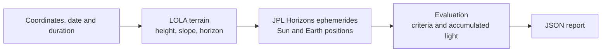
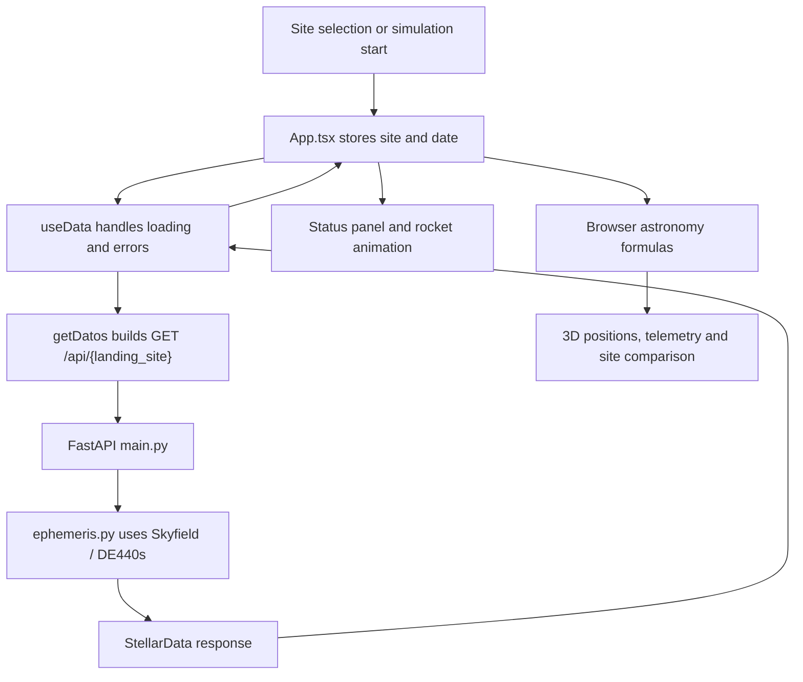

# Lunar Landing Site Navigator

## Official NASA data used in this project

**The scientific terrain and ephemeris inputs used by the backend come from official NASA data products and NASA/JPL services.**

- **Lunar terrain comes from LRO's Lunar Orbiter Laser Altimeter (LOLA).** Global and regional elevation grids distributed through NASA's Planetary Data System (PDS) provide the terrain heights used to calculate site elevation, local slopes and the surrounding horizon. [Official PDS LOLA archive](https://pds-geosciences.wustl.edu/missions/lro/lola.htm).
- **High-resolution south-polar terrain comes from NASA Goddard's Planetary Geodynamics Data Archive (PGDA).** The backend uses the LOLA `LDEM_83S_10MPP_ADJ.TIF` elevation model to calculate local slopes in its coverage area. [Official NASA Goddard product page](https://pgda.gsfc.nasa.gov/products/90).
- **Sun and Earth positions for the detailed site evaluation come from NASA/JPL Horizons.** The backend requests geometric positions for the selected lunar location and dates, then calculates local angles and illumination states. [Official JPL Horizons service](https://ssd.jpl.nasa.gov/horizons/).
- **The orbital API uses NASA/JPL DE440s ephemerides through Skyfield.** Skyfield reads the official `de440s.bsp` file to calculate astronomical positions. [Official JPL ephemeris reference](https://ssd.jpl.nasa.gov/planets/eph_export.html), [Skyfield documentation for DE440s](https://rhodesmill.org/skyfield/planets.html).

The project derives its slope statistics, illumination estimates and viability decisions from these inputs. The browser also implements its own approximate orbital calculations for visualization. Image credits and manually configured site presets are described in [Data sources and references](#data-sources-and-references).

> Given a point on the Moon and a date, it estimates whether the site meets the basic geometric conditions for a landing: gentle terrain, a visible Sun and Earth, and enough sunlight during the mission.

A **NASA Space Apps Challenge 2026** project. It combines real lunar topography (LOLA) with astronomical positions (JPL Horizons) and provides:

- an **evaluation engine** in Python that decides whether a site is viable and explains why,
- an **HTTP API** with Sun-Earth-Moon geometry,
- a **3D explorer** to visualize the system.

The explorer lets you browse lunar sites, change the date, compare approximate illumination and animate the Sun–Earth–Moon system. Selecting a site requests a simplified instantaneous assessment from the orbital API. The full terrain-aware mission report is available through the Python command line described below.

## Contents

- [What does it do?](#what-does-it-do)
- [Data sources and references](#data-sources-and-references)
- [How it decides](#how-it-decides)
- [Example: Apollo 11](#example-apollo-11)
- [Getting started](#getting-started)
- [Output](#output)
- [API and 3D explorer](#api-and-3d-explorer)
- [Frontend architecture](#frontend-architecture)
- [Code layout](#code-layout)
- [Tests](#tests)
- [Limitations](#limitations)
- [Glossary](#glossary)
- [Contributing, AI use and license](#contributing-ai-use-and-license)

## What does it do?

Choosing where to land on the Moon means answering several questions at once: is the ground flat enough? Will there be sunlight for power? Can Earth be seen for communications? This project answers all of them using real data.

You provide **lunar coordinates**, a **start date** and a **mission duration**. The system then:

1. Measures the **terrain** around the point: height, slope, and how high the horizon is in every direction.
2. Looks up where the **Sun and Earth** are, as seen from that point, throughout the mission.
3. Applies a set of **viability criteria** and returns a report with the decision and, if the site is not suitable, **every** reason why it fails.



Terrain is computed first because the ephemerides need the height of the site.

> Important: this is a geometric estimate. It does not certify that a landing is safe, but provide when it is unsafe and the reasons.

## Data sources and references

The following products are used by the current implementation. Heights, slopes, terrain horizons and illumination hours are computed by the project from these inputs.

| Input | Product used in the code | Role in the project |
| --- | --- | --- |
| Global lunar elevation | LRO/LOLA PDS cylindrical gridded data, `ldem_16.img` and its `.lbl` label by default. The loader also accepts 4 or 64 pixels per degree. | Site elevation and the 360-direction terrain horizon, searched out to 200 km by default. |
| Low- and mid-latitude elevation | LOLA cylindrical `ldem_1024_*` tiles, at 1024 pixels per degree, roughly 30 m north–south spacing. | Local slopes for sites strictly between 60° S and 60° N. The backend reads the required rows through HTTP Range requests. |
| South-polar elevation | NASA Goddard PGDA product 90, `LDEM_83S_10MPP_ADJ.TIF`, with 10 m projected pixel spacing. | Local slopes from 83° S toward the south pole, excluding the pole itself. Rasterio reads the required window of the remote Cloud Optimized GeoTIFF. |
| Sun and Earth positions at a lunar site | JPL Horizons API, geometric ICRF vectors with `VEC_CORR=NONE`. | Site-specific elevation, azimuth, distances and geometric Earth occultation of the Sun, used by `lunar_geometry.py`. |
| Orbital API positions | JPL `de440s.bsp`, loaded and cached by Skyfield in `backend/data/`. | Server-side orbital telemetry, trajectories and the simplified site assessment requested by the explorer. |

The global DEM has a default north–south spacing of about 1.9 km at 16 pixels per degree. The local slope calculation uses the higher-resolution products above within a 200 m radius. These two spatial scales affect different parts of the evaluation. The automatic slope coverage leaves gaps between 60° and 83° S and at latitudes of 60° N or higher. A compatible lunar GeoTIFF can be supplied through the Python `dem_local` argument for other locations.

The PDS labels define the elevation scaling and a reference lunar radius of 1,737,400 m. The PGDA product describes its lunar coordinate frame and provides separate uncertainty and effective-resolution layers. The code records terrain provenance in `metadatos`. Physical accuracy also depends on the product's effective resolution and reference frame. Grid spacing describes the sampling of the delivered raster. [PDS LOLA archive](https://pds-geosciences.wustl.edu/missions/lro/lola.htm), [PDS cylindrical product directory](https://pds-geosciences.wustl.edu/lro/lro-l-lola-3-rdr-v1/lrolol_1xxx/data/lola_gdr/cylindrical/img/), [PGDA south-polar product and documentation](https://pgda.gsfc.nasa.gov/products/90).

Horizons generates the requested ephemerides online. The backend converts the returned vectors into local angles and sampled illumination states. DE440s is a separate ephemeris file used by the orbital API through Skyfield. The browser computes its animation and displayed orbital telemetry using the analytical formulas in `frontend/src/astronomy/ephemeris.ts`. [JPL Horizons](https://ssd.jpl.nasa.gov/horizons/), [Horizons API documentation](https://ssd-api.jpl.nasa.gov/doc/horizons.html), [JPL planetary and lunar ephemerides](https://ssd.jpl.nasa.gov/planets/eph_export.html), [Skyfield ephemeris documentation](https://rhodesmill.org/skyfield/planets.html).

The frontend also contains a small manually maintained site list in `landingSites.ts` and three display images in `frontend/public/textures/`. The repository does not record individual source credits for those images. The Artemis/Shackleton entry and its date are configured demonstration values. Mission presets should be checked against mission records when used for historical interpretation. LROC QuickMap links open an external map for the selected coordinates. [LROC QuickMap](https://quickmap.lroc.asu.edu/).

## How it decides

### Criteria

A site is viable only if it meets **all** criteria. The default values can be changed.

| Code | Criterion | Default rule |
| :---: | --- | --- |
| 1 | Terrain **slope** | The 95th percentile (P95) of the slope must be **below 15°** |
| 2 | **Valid data** | Input data must be complete, valid and consistent with the site |
| 3 | **Unobstructed Sun** at start | Neither terrain nor an eclipse may block the Sun at the initial instant |
| 4 | **Earth visible** at start | Earth must be above the terrain horizon at the initial instant |
| 5 | **Solar elevation** at start | The Sun must be **more than 5°** above the horizon |
| 6 | **Accumulated light** | Hours of light must exceed **50%** of the mission hours |
| 7 | **Time coverage** | The data series must cover the whole requested duration |

How some of them are interpreted:

- **Light (criterion 6):** an hour counts as light when the Sun is above the terrain horizon and there is no eclipse. For a 24 h mission, the site needs more than 12 h of light. The percentage can be changed with `--min-porcentaje-luz`.
- **"Initial" criteria (3, 4 and 5):** they are checked only at the landing instant. Criterion 6 covers the whole mission.
- **Time integration:** each interval takes the state of its left sample, and the last sample adds no duration.

### Possible outcomes

| `viable` | `estado` | Meaning |
| :---: | --- | --- |
| `true` | `viable` | Meets all criteria |
| `false` | `no_viable` | Fails at least one criterion. The report lists **all** evaluable failures |
| `null` | `datos_insuficientes` | Data is missing and no evaluated criterion has rejected the site (`evaluacion_completa: false`) |

A known rejection always takes priority over missing data. For example, a P95 slope of 20° with empty ephemerides gives `viable: false` with failures 1 and 2.

Cases that produce `datos_insuficientes`:

- A P95 slope that is present but invalid (empty, text, `NaN` or outside 0–90°), or both slope metrics missing (failure 2). If P95 is missing but the maximum slope exists, the maximum is used and the report says so.
- Missing or inconsistent required data: incomplete horizon, empty ephemerides, invalid angles, missing eclipse flag, a date without time zone, or coordinates that do not match the site (failure 2).
- Incomplete time coverage, for example requesting 24 h and receiving samples only up to hour 23 (failure 7).

If JPL Horizons does not respond during the computation, the full flow fails with an error before reaching the evaluator, instead of returning `null`.

## Example: Apollo 11

Evaluation of the Apollo 11 site over 14 days (336 h), with one sample per hour, starting on 9 November 2026:

```sh
python backend/evaluar.py --tiempo 2026-11-09T00:00:00Z --lat 0.674 --lon 23.473 --horas 336 --paso-horas 1
```

Result (abridged):

```json
{
  "sitio_0_674_23_473": {
    "viable": false,
    "estado": "no_viable",
    "evaluacion_completa": true,
    "fallos": [5],
    "detalle_fallos": [
      {
        "codigo": 5,
        "descripcion": "Elevación solar inicial igual o inferior al mínimo configurado.",
        "mensaje_tecnico": "Elevación solar -74.1211°; se exige > 5°."
      }
    ],
    "datos_tecnicos": {
      "pendiente_evaluada_deg": 1.03,
      "sol_elevacion_t0_deg": -74.1211,
      "horas_totales_luz": 191.0,
      "porcentaje_luz": 56.85
    }
  }
}
```

> Field names and message texts in the report are in Spanish.

The terrain is almost flat (P95 slope of 1.03°) and the site has sunlight for 56.8% of the mission, above the required 50%. However, **it is rejected because the mission would start at night**: the Sun is 74° below the horizon at the landing instant. With a different start date, the same site could be viable.

## Getting started

### Requirements

- Python 3.12
- Node.js and npm (only for the 3D explorer)
- Internet connection: LOLA and JPL Horizons are queried

### Installation

From the repository root. In PowerShell:

```powershell
python -m venv .venv
.\.venv\Scripts\Activate.ps1
python -m pip install -r backend/requirements.lock
```

On Linux or macOS, activate the environment with `source .venv/bin/activate`. If `.venv` already exists, just activate it.

### Evaluate a site

```sh
python backend/evaluar.py --tiempo 2026-11-15T12:00:00Z --lat 0.674 --lon 23.473 --horas 24 --paso-horas 1
```

| Option | Meaning |
| --- | --- |
| `--tiempo` | Landing instant (UTC, ISO 8601 format) |
| `--lat`, `--lon` | Latitude and longitude of the site, in degrees |
| `--horas` | Mission duration |
| `--paso-horas` | Spacing between simulation samples |
| `--min-porcentaje-luz` | Minimum percentage of light (default: 50) |
| `--carpeta` | Output folder (default: `backend/results/`) |
| `--entrada` | Re-evaluates an existing file without querying services (see below) |

All options: `python backend/evaluar.py --help`.

**First run:** it downloads the global LOLA elevation model (DEM) to `backend/data/lola`. High-resolution slopes are only available inside the automatic coverage area. Outside it, a compatible GeoTIFF is needed, passed to `calcular_terreno(dem_local=...)`. The exact poles are not supported.

### Re-evaluate without querying services

To change criteria or repeat an evaluation from data that was already computed:

```sh
python backend/evaluar.py --entrada backend/results/peticion_ID/datos_lunares.json
```

It prints the report as JSON and does not modify any file.

### Use it from Python

From the `backend/` directory, or with that directory on your Python import path, run the following.

```python
from evaluar import procesar_peticion_frontend

result = procesar_peticion_frontend(
    tiempo="2026-11-15T12:00:00Z",
    latitud=0.674,
    longitud=23.473,
    duracion_horas=24,
    carpeta_salida=None,
)
print(result["evaluacion"])
```

With `carpeta_salida=None`, nothing is written to disk.

## Output

Each evaluation is saved in `backend/results/peticion_<id>/`:

| File | Contents |
| --- | --- |
| `terreno.json` | Height, maximum and P95 slope, horizon, and data provenance |
| `efemerides.json` | Instant, location, and Sun and Earth time series |
| `datos_lunares.json` | Combined input received by the evaluator |
| `evaluacion.json` | Decision, failures, metrics and coverage |

Only the **latest request** is kept: every valid request deletes the previous results in its output folder. A lock prevents simultaneous writes, and if the computation fails, no partial folder is published.

### Structure of the evaluation report

| Field | Contents |
| --- | --- |
| `version_contrato` | Version of the report format |
| `sitio_id`, `nombre`, `coordenadas`, `t0_aterrizaje` | Identification of the site and the landing instant |
| `viable`, `estado`, `evaluacion_completa` | The decision (see [possible outcomes](#possible-outcomes)) |
| `fallos` | List of codes of the failed criteria |
| `detalle_fallos` | For each failure: code, description, technical message and technical data |
| `diccionario_fallos` | Meaning of each failure code (1 to 7) |
| `criterios_no_evaluados` | Criteria that could not be evaluated |
| `mensaje_tecnico` | One-sentence summary of the decision |
| `parametros_mision` | Thresholds used in this evaluation |
| `cobertura_temporal` | Hours requested and observed, and whether they suffice to evaluate light |
| `datos_tecnicos` | Computed metrics: slope, initial angles, hours of light, hours lost to eclipse or terrain, first loss of light and of communication |
| `modelo` | Assumptions and simplifications of the computation |
| `metadatos_terreno` | LOLA product used, resolution, method and limits of the terrain computation |
| `procedencia_efemerides` | Source, location, units and model of the ephemerides |

### Default mission parameters

| Parameter | Value | Meaning |
| --- | :---: | --- |
| `max_pendiente_deg` | 15 | Maximum P95 slope |
| `min_angulo_solar_deg` | 5 | Minimum solar elevation at start |
| `min_porcentaje_luz` | 50 | Minimum percentage of the mission with light |
| `min_delta_sol_t0_deg` | 0.5 | Minimum margin of the Sun above the terrain horizon at start |
| `min_delta_tierra_t0_deg` | 0 | Minimum margin of Earth above the terrain horizon at start |

## API and 3D explorer

### API

```sh
python -m uvicorn app.main:app --app-dir backend --host 0.0.0.0 --port 3001 --workers 1
```

Interactive documentation of the contracts: <http://localhost:3001/docs>.

| Route | Purpose |
| --- | --- |
| `GET /api/health` | Health check |
| `GET /api/ephemeris` | Sun-Earth-Moon orbital positions |
| `GET /api/trajectory` | Orbital trajectory |
| `GET /api/{landing_site}` | Simplified instantaneous Sun/Earth assessment used by the current UI, accepting `fecha`, `lat`, `lon` and `name` |
| `POST /api/lunar-geometry` | Sun and Earth geometry seen from a lunar site (no terrain or evaluation) |

`POST /api/lunar-geometry` responds with a 502 error if Horizons returns an invalid response and 504 if it times out. Example request:

```json
{
  "lugar": {"nombre": "Apolo 11", "latitud_deg": 0.67416, "longitud_deg": 23.47314, "altura_m": 0},
  "inicio_utc": "2026-11-15T12:00:00Z",
  "duracion_segundos": 86400,
  "paso_segundos": 3600
}
```

The full evaluation (terrain + ephemerides + criteria) is run with `evaluar.py`.

The lock on simultaneous queries is local to the process, so use **a single worker or instance**. The `CORS_ORIGINS` environment variable sets the allowed HTTP origins.

### 3D explorer

With Node.js installed and the Python environment active:

```sh
npm install
npm run dev
```

Open the local URL printed by Vite, normally `http://localhost:5173`. The root `dev` script starts both Uvicorn on port 3001 and Vite. The Python environment must be active in that terminal so the backend dependencies are available.

The initial view is the lunar globe. Rotate or zoom it, select a marked site or add custom coordinates. Selecting a preset also applies its configured date and opens the orbital view. In that view you can edit the UTC date, choose a camera, compare sites and start or pause the animation. Space toggles playback, left/right arrows move one day, and up/down arrows move one hour.

Vite proxies `/api` to port 3001. Set `BACKEND_URL` to change the proxy target. `VITE_API_URL` sets the browser API base URL at build time for clients using `apiBase.ts`; an empty value keeps requests on the current origin. The lunar-geometry client currently uses a relative `/api/lunar-geometry` URL. A static deployment needs the appropriate API URL or a reverse proxy for the clients it uses.

Other scripts: `npm run evaluate -- --lat ... --lon ...`, `npm run test:backend` and `npm run build`.

## Frontend architecture

The frontend is a React and TypeScript single-page application built with Vite. React Three Fiber connects React components to Three.js, while Drei supplies camera controls, labels, stars and texture loading. Navigation between the globe and orbital views is held in React state. `main.tsx` mounts `App.tsx` directly, and `styles.css` styles the HTML controls and panels layered over the 3D canvas.

### Components and responsibilities

| File or directory under `frontend/src/` | Responsibility |
| --- | --- |
| `App.tsx` | Owns the selected site, date, active view, playback speed, camera mode and panel visibility. Renders the controls and chooses which scene to mount. |
| `components/MoonExplorerScene.tsx` | Renders the textured lunar sphere, coordinate grid, poles and selectable site markers. Converts pointer positions into lunar coordinates and handles camera zoom. |
| `components/SolarSystemScene.tsx` | Renders the Sun, Earth, Moon and orbital reference lines. Advances the animation clock and updates object transforms and camera tracking. |
| `components/RocketPlaceholder.tsx` | Animates an illustrative approach or failure sequence using the selected site and the API assessment. |
| `components/CanvasErrorBoundary.tsx` | Displays an error panel when the 3D view fails. React `Suspense` handles loading of scene assets. |
| `astronomy/ephemeris.ts` | Browser-side orbital approximations, Julian-date conversion and mapping of positions into scene coordinates. |
| `astronomy/landingSites.ts` | Site presets, coordinate formatting, QuickMap links and approximate instantaneous Sun/Earth visibility on a spherical Moon. |
| `hooks/useStellarData.tsx` | Exports `useData`, which manages site requests, loading, errors and the most recent response. Its effect cleanup ignores responses from superseded selections. |
| `services/getData.tsx` | Builds the selected-site GET request and checks HTTP status and JSON content type. |
| `model/datosEstelares.tsx` | Defines the response consumed by the UI through the fields `name`, `funciona`, `tipo_despegue` and `tipo_fallo`. |
| `api/apiBase.ts` | Resolves the configured backend address for the health, orbital and site clients. |
| `api/ephemerisClient.ts` | Provides the health check used by `App` and an orbital telemetry client available for integration. |
| `api/lunarGeometryClient.ts` | Defines the typed Horizons geometry contract and POST client available for integration. |

The active entry point imports `App` directly. `pages/mainPage.tsx` contains an unused page scaffold. The scene textures are served from `frontend/public/textures/`; `astronomy/textures.ts` supplies the generated Sun glow used in the orbital scene.

### What happens when a site is selected



The orbital scene updates Three.js objects on each frame through `useFrame`. A shared `jdRef` holds the simulation date, and the scene sends date samples back to React approximately every 80 ms during playback to refresh the displayed controls and telemetry. Backend site requests occur when selecting a site or starting playback. As the animation advances, local illumination values continue to update while the server assessment remains associated with its requested instant.

The status panel uses `funciona` from the selected-site response when available and otherwise derives a provisional status from local Sun/Earth visibility. The API health indicator comes from `/api/health`. The animated trajectories and orbital distances use presentation scales, and the rocket follows a scripted sequence.

### Connection to the full evaluation

| Capability | Current entry point | Result |
| --- | --- | --- |
| Interactive globe, animation and comparison | React scenes and local astronomy functions | Approximate visual geometry |
| Selected-site UI assessment | `GET /api/{landing_site}` | Instantaneous `StellarData` based on spherical illumination and Earth visibility |
| Detailed lunar-site geometry | `POST /api/lunar-geometry` | Horizons time series with local angles and eclipse flags |
| Terrain-aware mission evaluation | `python backend/evaluar.py ...` | LOLA terrain, Horizons series, P95 criterion, accumulated light and the `viable` report |

The mounted UI calls the health and selected-site endpoints. The orbital telemetry and lunar-geometry clients are available in the source tree with no active scene callers. Connecting the full mission report requires an HTTP entry point for `procesar_peticion_frontend` and a UI that accepts mission duration, displays the evaluation fields and handles all three `viable` outcomes.

## Code layout

```text
backend/
  evaluar.py                  Single entry point: compute or re-evaluate (CLI)
  app/
    terrain.py                Terrain: height, slope and horizon (LOLA)
    evaluation.py             Viability criteria and failure report
    astronomy/
      lunar_geometry.py       Ephemerides (JPL Horizons) and time series
      ephemeris.py            Sun-Earth-Moon orbits (Skyfield) for the visual API
    main.py                   FastAPI application and orbital routes
    lunar_api.py              HTTP contract for lunar geometry
  tests/                      Tests that need no network
  requirements.txt            Direct dependencies
  requirements.lock           Exact versions for Python 3.12
  requirements-dev.txt        Test dependencies
  data/                       Local downloads (not versioned)
  results/                    Latest evaluation (not versioned)
frontend/
  src/main.tsx                React entry point
  src/App.tsx                 Application state, controls and scene selection
  src/styles.css              Active application styles
  src/api/                    HTTP clients
  src/astronomy/              Calculations and data for the visualization
  src/components/             React scenes and components
  src/hooks/                  Request state and loading/error handling
  src/services/               Selected-site HTTP request
  src/model/                  Selected-site response type
  public/textures/            Earth, Moon and Sun display images
  vite.config.ts              Development and preview API proxy
AI_use.md                     AI usage log
challenge.md                  Challenge context
```

### The four computation modules

It helps to read them in this order:

| File | What it does |
| --- | --- |
| `backend/evaluar.py` | Validates date, coordinates and sampling, and coordinates terrain → ephemerides → evaluation. Builds the combined file and saves the latest request. Contains the only CLI. |
| `backend/app/terrain.py` | Opens the global elevation model and interpolates the height. Estimates the horizon in 360 directions (one per degree) accounting for lunar curvature, and the slope with the Horn 3×3 method inside a circle of 200 m radius centered on the site. |
| `backend/app/astronomy/lunar_geometry.py` | Queries Horizons, validates the tables, converts vectors to elevation and azimuth, and detects geometric eclipses. |
| `backend/app/evaluation.py` | Checks that the series matches the site, applies the criteria and integrates the states over time. It does not query services or write files. |

The API adds `main.py`, `lunar_api.py` and `ephemeris.py`. The latter uses the DE440s kernel through Skyfield (downloaded to `backend/data` when needed) and plays no part in the site evaluation.

## Tests

```sh
python -m pip install -r backend/requirements-dev.txt
cd backend
python -B -m unittest discover -s tests
```

| File | What it checks |
| --- | --- |
| `test_landing_evaluation.py` | Rules, percentages, durations, invalid data, integration, persistence, cleanup and locking |
| `test_terrain_p95.py` | Synthetic terrains (flat and with peaks), GeoTIFF, cylindrical tiles and rejection without coverage |
| `test_lunar_api.py` | HTTP contract, Horizons errors, geometry and eclipses with simulated responses |

The tests do not download data or validate the scientific accuracy of the remote sources.

## Limitations

- **It is a geometric estimate.** It does not simulate the descent or include a thermal or energy balance.
- **Horizon:** one sample per degree of azimuth; it cannot resolve obstacles smaller than the resolution of the elevation model.
- **Slope:** evaluated only inside the 200 m circle. The 30 m spacing of the LOLA grid does not guarantee a 30 m effective resolution.
- **Communication:** the visibility of the center of the Earth is checked. It does not guarantee a link with a specific station.
- **Eclipses:** the Sun is treated as a point and Earth as a sphere.
- **Poles:** the exact poles are not supported, and reliability decreases near them.
- **Coverage:** outside the automatic LOLA coverage, you must supply your own GeoTIFF.

## Glossary

| Term | Meaning |
| --- | --- |
| **LOLA** | Lunar Orbiter Laser Altimeter: an instrument on NASA's LRO spacecraft that measures lunar terrain height with a laser |
| **DEM** | Digital elevation model: a grid of terrain heights |
| **JPL Horizons** | Jet Propulsion Laboratory service that computes the positions of solar system bodies |
| **Ephemerides** | A table of the positions of a celestial body over time |
| **Terrain horizon** | Angular height of the terrain as seen from the site in each direction. A body below that angle is hidden |
| **Elevation and azimuth** | Height above the horizon and compass direction (0° north, 90° east, 180° south, 270° west) |
| **95th percentile (P95)** | A slope threshold at or below which approximately 95% of sampled slopes fall. It reduces the influence of the steepest samples |
| **Horn 3×3** | Method for computing slope from the 8 neighbors of each grid cell |
| **Geometric eclipse** | A case in which Earth lies between the Sun and the site, computed with simple geometry |

## Contributing, AI use and license

- **Contributing:** before submitting a change, run the [tests](#tests). Use the current execution and import paths: `backend/evaluar.py` and the modules in `backend/app/`.
- **AI use:** all use of AI must be recorded in [AI_use.md](AI_use.md), stating its purpose and how the output was incorporated.
- **Data:** LOLA products from PDS/PGDA and JPL Horizons ephemerides. The orbital API uses DE440s through Skyfield.
- **License:** to be decided.
